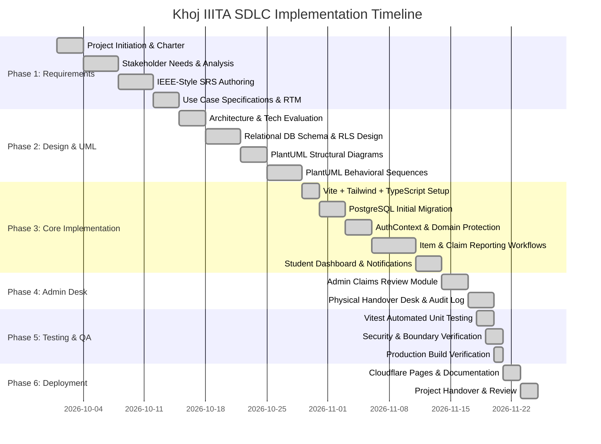

# Project Gantt Chart & Milestone Timeline
## Khoj — IIITA Lost & Found Platform
**Institution:** Indian Institute of Information Technology Allahabad  
**Course:** Software Engineering  
**Academic Cycle:** Autumn 2026  

---

---

## SDLC Work Breakdown by Phase

| Phase | Duration | Core Deliverables | Verification Metric |
|---|---|---|---|
| **Phase 1: Inception & Requirements** | 14 Days | SRS.md, Requirement_Analysis.md, Use_Cases.md, RTM.md | Stakeholder sign-off & traceability matrix baseline |
| **Phase 2: Architectural & DB Design** | 14 Days | Architecture_Design.md, Database_Design.md, 12 PlantUML models | Relational 3NF validation, RLS design review |
| **Phase 3: Client & Backend Engineering** | 14 Days | Supabase migration, React components, hooks, storage integration | Unit testing of domain constraints & file upload validation |
| **Phase 4: Admin Portal Operations** | 7 Days | Claims management, handover tracking, audit logging | Dispute resolution and multi-claim testing |
| **Phase 5: Quality Assurance & Testing** | 5 Days | Test_Plan.md, Test_Cases.md (40 cases), Vitest automated suite | 100% test pass rate & strict TypeScript build pass |
| **Phase 6: Deployment & Handover** | 4 Days | Cloudflare Pages config, Maintenance Plan, README, CHANGELOG | Production web bundle ready for edge deployment |
