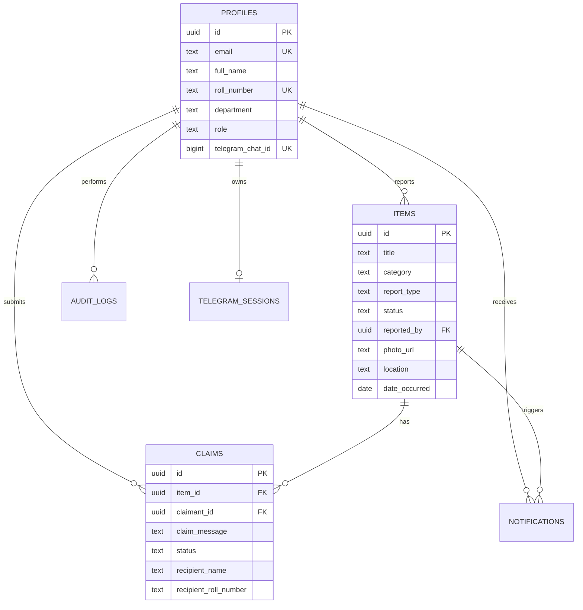
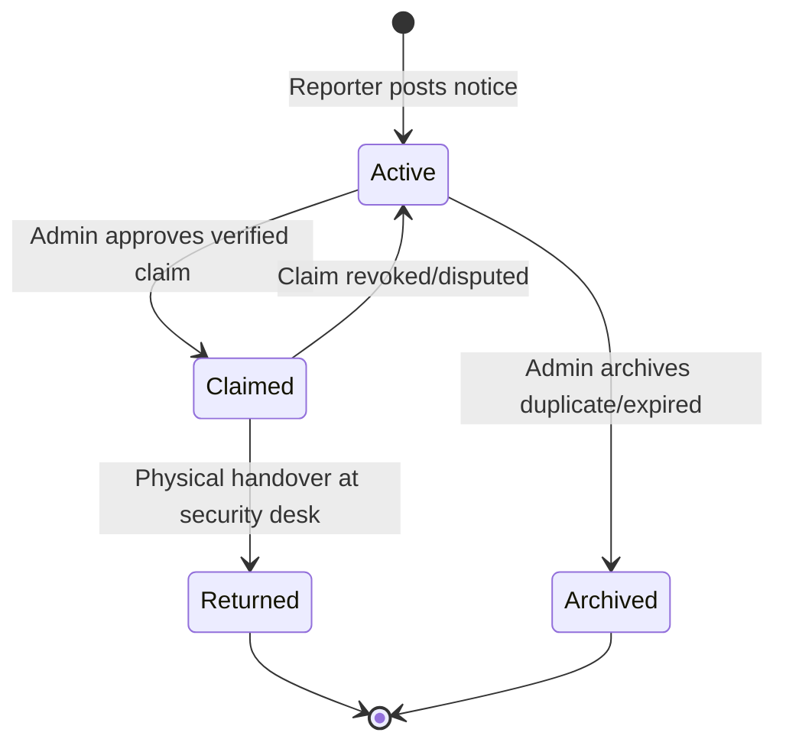

# Khoj — IIITA Lost & Found Platform
## Master Academic Project Presentation Deck (Slide-by-Slide & Line-by-Line)

**Author:** Chandranshu (Roll Number: `IIT2025098`)  
**Institution:** Indian Institute of Information Technology Allahabad (IIITA)  
**Department:** Department of Information Technology  
**Project Track:** Software Engineering SDLC Capstone Project  
**Live Production URL:** [https://khoj-pink.vercel.app/](https://khoj-pink.vercel.app/)  
**Telegram Bot:** `@iiita_khoj_bot`  
**Database:** Supabase Cloud (PostgreSQL 15+)  

---

## Slide 1: Title Slide

### Visual Content
* **Title:** Khoj — IIITA Lost & Found Platform
* **Subtitle:** An Institutional Campus Asset Recovery System with Dispute-Proof Ownership Verification & Omnichannel Architecture
* **Presenter:** Chandranshu (Roll: `IIT2025098`)
* **Guide / Evaluator:** Department of Information Technology, IIIT Allahabad
* **Live System:** `https://khoj-pink.vercel.app/`
* **Bot Interface:** Telegram `@iiita_khoj_bot`
* **Badges:** `React 19` • `TypeScript` • `PostgreSQL 15` • `Vite 6` • `Tailwind CSS` • `Vercel Edge`

### Speaker Notes (What to say line by line)
> "Good morning respected professors and evaluators. Today I am presenting **Khoj**, a production-grade, institutional Lost & Found web platform engineered specifically for the Indian Institute of Information Technology Allahabad. 
> 
> Khoj is not just a digital noticeboard; it is an end-to-end asset recovery ecosystem featuring strict institutional domain authentication, two-tier dispute-proof ownership verification, security desk physical handover protocols, and an omnichannel conversational bot on Telegram. The entire application is deployed live in production at `khoj-pink.vercel.app` backed by Supabase PostgreSQL and Vercel edge infrastructure."

---

## Slide 2: Problem Statement & Motivation

### Visual Content
| Existing Campus Channel | Inherent Failure Points | Real Impact on Students |
| :--- | :--- | :--- |
| **WhatsApp Batches / Groups** | Notices drown in chat noise within 2 hours; unsearchable | 78% of reported lost items are never recovered |
| **Mass Institute Broadcast Emails** | Inbox clutter; flagged as spam; lack photo preview | Information fatigue; overlooked notices |
| **Physical Noticeboards** | Confined to one location (e.g., CC3 or SAC); weather-damaged | Low visibility across hostels and departments |
| **Ad-Hoc Handover at Guard Desks** | Zero chain of custody; no identity logging | High risk of false claiming and disputes |

### Key Takeaways
1. **No Institutional Gate:** External persons could claim expensive laptops, earbuds, or calculators.
2. **Privacy Vulnerability:** Students frequently post personal phone numbers on public social groups.
3. **Absence of Audit Trail:** If an item is handed over to the wrong claimant, there is zero verifiable record.

### Speaker Notes
> "On our campus at IIIT Allahabad, losing an item—be it a college ID card, scientific calculator, room key, or laptop charger—is an all-too-common occurrence. Historically, students have relied on informal channels: blasting WhatsApp batch groups, sending mass broadcast emails, or posting on unofficial Discord servers.
> 
> These methods suffer from four critical architectural flaws:
> First, visibility decay: a lost item message is buried under hundreds of chat messages in minutes.
> Second, security risk: there is no verification mechanism, meaning anyone can falsely claim an item without proving ownership.
> Third, privacy exposure: students end up exposing their private contact numbers publicly.
> And fourth, zero chain of custody: security desks have no standardized log of who collected an item.
> Khoj was engineered to replace this chaotic process with a secure, centralized institutional system."

---

## Slide 3: Project Vision & Core Objectives

### Visual Content
```
               ┌────────────────────────────────────────────────────────┐
               │                KHOJ SYSTEM OBJECTIVES                  │
               └────────────────────────────────────────────────────────┘
                                           │
         ┌───────────────────┬─────────────┴───────┬───────────────────┐
         ▼                   ▼                     ▼                   ▼
┌─────────────────┐ ┌─────────────────┐ ┌─────────────────┐ ┌─────────────────┐
│ Institutional   │ │ Dispute-Proof   │ │ Verified Desk   │ │ Omnichannel     │
│ Domain Boundary │ │ Claim Dossier   │ │ Handover Audit  │ │ Telegram Bot    │
│ (@iiita.ac.in)  │ │ (2-Factor Proof)│ │ (ID Card Check) │ │ (30-Sec Reports)│
└─────────────────┘ └─────────────────┘ └─────────────────┘ └─────────────────┘
```
* **Zero-Cost Constraint:** Operates 100% on free tiers (Vercel CDN + Supabase PostgreSQL + Telegram API).
* **Closed-Campus Intranet Wall:** Non-authenticated visitors cannot inspect internal campus notices.
* **Auditability:** Complete accountability with an immutable database audit log.

### Speaker Notes
> "The vision of Khoj is encapsulated in four core engineering objectives:
> Number one: **Institutional Security Boundary**. Every user must authenticate via Google OAuth using their verified `@iiita.ac.in` email. Non-campus accounts are rejected at the database level.
> Number two: **Dispute-Proof Ownership Claims**. Claimants must submit confidential evidence dossiers (serial numbers, invoice photos, lock-screen descriptions) verified against hidden marks entered by the finder.
> Number three: **Physical Handover Governance**. Physical returns at the security desk require administrative ID inspection, where the recipient's roll number is permanently logged.
> And number four: **Omnichannel Accessibility**. Students can report lost or found items directly from Telegram in under 30 seconds without opening a browser."

---

## Slide 4: Software Engineering SDLC Methodology

### Visual Content
* **SDLC Model:** Agile Scrum with Iterative Sprint Deliverables.
* **Sprint Breakdown:**
  * **Sprint 1 (Days 1–3): Requirements & Architecture**  
    * IEEE 830-compliant SRS, Use Case Specifications, Database Schema, and RLS policies.
  * **Sprint 2 (Days 4–6): Core Web Platform & Institutional Auth**  
    * React 19 SPA, Google OAuth domain filter, Noticeboard with multi-filter search, Supabase Storage integration.
  * **Sprint 3 (Days 7–9): Claim Verification & Admin Management Desk**  
    * Two-factor claims desk, physical handover verification modal, immutable audit trail, automated competing claim rejections.
  * **Sprint 4 (Days 10–12): Omnichannel Telegram Bot, QA & Live Deployment**  
    * Serverless Webhook on Vercel, `@iiita_khoj_bot` state machine, Vitest test suites (40 test cases), production go-live on Vercel.

### Speaker Notes
> "To execute this project rigorously, we adopted an Agile Scrum methodology divided into four structured sprints. 
> Rather than jumping straight to coding, Sprint 1 was dedicated to foundational software engineering: authoring an IEEE 830 SRS, establishing a Requirements Traceability Matrix, and designing PostgreSQL schemas with Row-Level Security.
> Sprint 2 focused on frontend engineering with React 19, TypeScript, and Tailwind CSS.
> Sprint 3 delivered the administrative core: claim reviews, handover logging, and audit tracking.
> Finally, Sprint 4 introduced our omnichannel Telegram bot, automated test execution, and production deployment on Vercel."

---

## Slide 5: Requirements Engineering (Functional Requirements)

### Visual Content
| Req ID | Requirement Title | Technical Implementation |
| :--- | :--- | :--- |
| **FR-01** | Institutional Domain Restriction | Enforced via GoTrue OAuth `hd=iiita.ac.in` and DB `CHECK (email LIKE '%@iiita.ac.in')` |
| **FR-02** | Mandatory Closed-Campus Wall | Router guard redirects all unauthenticated traffic to `/login` |
| **FR-05** | Found Item Reporting | Multipart upload to Supabase Storage `item-photos` bucket |
| **FR-07** | Secret Distinguishing Marks | Column `distinguishing_details` visible only to admin and reporter |
| **FR-11** | Dynamic Noticeboard Filtering | Full-text query on `title`, `description`, `location` + category filters |
| **FR-15** | Ownership Claim Dossier | Inserts into `claims` table with proof details and optional receipt upload |
| **FR-20** | Admin Verification & Auto-Reject | Single approval automatically marks competing claims as `rejected` |
| **FR-24** | Physical Desk Handover | Admin logs verified student roll number; transitions item to `returned` |
| **FR-28** | Immutable Security Audit | Triggers insert into `audit_logs` (read-only for admins; UPDATE/DELETE revoked) |

### Speaker Notes
> "Our functional requirements were mapped with precision. 
> Highlights include:
> FR-01 and FR-02 guarantee that only verified IIITA members can access notices.
> Under FR-07, when a student reports a found item, they can record 'secret distinguishing marks' that are hidden from public view.
> Under FR-20, when an administrator approves a claim, the system atomically updates the claim to `awaiting_handover`, transitions the item to `claimed`, and automatically marks all competing claims as `rejected`.
> FR-24 guarantees that items are never marked 'returned' until the student physically presents their college ID card at the desk."

---

## Slide 6: Non-Functional Requirements & Design Constraints

### Visual Content
* **Performance (NFR-01):**
  * Time-to-Interactive (TTI) < 1.2s on mobile networks.
  * Supabase PostgREST read queries execute in under 45ms.
* **Security & Confidentiality (NFR-02):**
  * Multi-tenant Row-Level Security (RLS) on all database tables.
  * Claim proof evidence stored in a private bucket (`claim-evidence`).
* **Zero-Cost Budget Constraint (NFR-03):**
  * Total Monthly Cloud Spend: **$0.00** (Free Vercel Edge CDN + Free Supabase PostgreSQL + Free Telegram Bot API).
* **Usability & Accessibility (NFR-04):**
  * Custom IIITA campus noticeboard theme (warm terracotta `primary-600` `#e9741e` on `surface-50`).
  * Full keyboard accessibility, responsive grid layout for mobile, tablet, and desktop.

### Speaker Notes
> "On the non-functional side, our primary constraints were performance, security, and a strict zero-cost budget constraint.
> To keep the platform 100% free for the university indefinitely, we selected modern cloud-native primitives: Vercel's global CDN for static assets and serverless functions, paired with Supabase's managed PostgreSQL.
> Security is enforced at the database engine level through Row-Level Security policies, ensuring that client-side tampering is rendered impossible."

---

## Slide 7: System Architecture & Tech Stack

### Visual Content
```
┌────────────────────────────────────────────────────────────────────────┐
│                        CLIENT / INTERACTION TIER                       │
│   React 19 SPA (TypeScript + Tailwind)   │   Telegram Messenger Client │
└───────────────────────┬───────────────────┴─────────────┬──────────────┘
                        │ HTTPS                           │ HTTPS Webhook
                        ▼                                 ▼
┌────────────────────────────────────────────────────────────────────────┐
│                        APPLICATION / EDGE TIER                         │
│       Vercel Global Edge CDN             │    Vercel Serverless API    │
│   • Client-side SPA Routing              │    • /api/telegram.ts       │
│   • vercel.json SPA Rewrites             │    • Bot State Machine      │
└───────────────────────┬───────────────────┴─────────────┬──────────────┘
                        │ REST / WebSocket                │ Service RPC
                        ▼                                 ▼
┌────────────────────────────────────────────────────────────────────────┐
│                          DATA / BACKEND TIER                           │
│                       Supabase Cloud Platform                          │
│   • GoTrue Auth (Google OAuth)           • PostgREST Auto-APIs         │
│   • PostgreSQL 15+ (RLS + Triggers)      • S3-Compatible Storage       │
└────────────────────────────────────────────────────────────────────────┘
```

### Speaker Notes
> "This slide illustrates our system architecture. 
> At the client tier, students interact either through our React 19 single-page application or natively via the Telegram messenger bot.
> At the application tier, Vercel hosts both the compiled static assets across global edge nodes and the serverless webhook function `/api/telegram`.
> At the data tier, Supabase manages authentication, database transactions, real-time WebSocket subscriptions, and media storage. The frontend communicates directly with PostgreSQL via auto-generated PostgREST APIs protected by database-level security policies."

---

## Slide 8: Database Architecture & Schema Design

### Visual Content


### Speaker Notes
> "Our relational schema is built around six normalized tables in PostgreSQL. 
> The `profiles` table anchors student identities, capturing their verified roll number, department, and role.
> The `items` table stores lost and found notices with category, status, and photo URLs.
> The `claims` table links claimants to items with a unique composite constraint `(item_id, claimant_id)` to prevent spam.
> Notice the referential integrity: foreign key constraints on `claims` and `notifications` are configured with `ON DELETE CASCADE` to guarantee clean data lifecycles."

---

## Slide 9: Database Security & Row Level Security (RLS)

### Visual Content
* **Total RLS Policies:** 24 fine-grained policies active across all tables.
* **Key Policies:**
  1. `profiles: users can update own profile (no role change)`  
     * Prevents privilege escalation by disallowing students from altering their `role` column.
  2. `items: authenticated can read public listings`  
     * Enforces `status IN ('active', 'claimed', 'returned')`.
  3. `items: admins can delete any`  
     * Gated strictly by `public.is_admin()`.
  4. `audit_logs: immutable trail`  
     * Only `SELECT` and `INSERT` permitted; `UPDATE` and `DELETE` permanently blocked.
  5. `public.publish_item_from_bot()`  
     * `SECURITY DEFINER` function allowing the Telegram webhook to insert items safely without exposing service-role secret keys.

### Speaker Notes
> "Security in Khoj is not merely handled in React; it is enforced directly within the PostgreSQL engine via Row-Level Security.
> Even if a malicious actor intercepts network requests and attempts to update another student's item or promote their own account to 'admin', PostgreSQL checks the user's JWT `auth.uid()` and rejects the transaction.
> Furthermore, the audit log table has zero update or delete policies—once an entry is logged, it is mathematically permanent."

---

## Slide 10: UML Structural Models (Class & Component Diagrams)

### Visual Content
* **Class Diagram Highlights:**
  * Core Domain Classes: `Profile`, `Item`, `Claim`, `Notification`, `AuditLog`.
  * Custom UI Primitives: `ConfirmDialog`, `Modal`, `StatusBadge`, `CategoryIcon`, `ImageUpload`, `SearchBar`.
  * Data Access Hooks: `useItems()`, `useClaims()`, `useAdmin()`.
* **Component Diagram Highlights:**
  * Clean boundary between the `AuthContext` provider, Page Routers, and API communication layers.
  * Decoupled Storage Service module handling client-side MIME validation and file sizing prior to upload.

### Speaker Notes
> "In our UML Class Model, we adopted clean component-based separation. 
> Custom React hooks—`useItems`, `useClaims`, and `useAdmin`—encapsulate all PostgREST operations and error handling, keeping our page components purely representational.
> Our Component Diagram illustrates how the presentation layer consumes state from the centralized `AuthContext` and `NotificationContext`, which maintain real-time sync with Supabase WebSockets."

---

## Slide 11: UML Behavioral Models (State Machine & Handover Sequence)

### Visual Content

* **Handover Sequence Protocol:**
  1. Claimant presents physical IIITA ID card at desk.
  2. Admin enters Roll Number & Name in `/admin/handovers`.
  3. System updates Claim and Item status to `returned`.
  4. Database writes `handover_confirmed` to `audit_logs`.
  5. Real-time push notifications delivered to both founder and claimant.

### Speaker Notes
> "This State Machine Diagram highlights the lifecycle of a campus item. 
> An item begins in the `Active` state upon submission. When an administrator approves an ownership claim, it shifts to `Claimed`. 
> Crucially, it does not become `Returned` until physical verification occurs.
> In the Handover Sequence, the admin physically inspects the student's ID card, enters their verified roll number into the system, and commits the transaction. This creates an unshakeable digital record of asset transfer."

---

## Slide 12: Core Feature Walkthrough: Institutional Gate & Noticeboard

### Visual Content
* **Closed Campus Authentication:**
  * Unauthenticated users cannot view notices or student names; redirected to `/login`.
  * One-click Google OAuth restricted strictly to `@iiita.ac.in`.
* **Campus Noticeboard (`/browse`):**
  * Live debounced text search across item titles, locations, and descriptions.
  * Real-time filtering by Category (Electronics, Documents, Keys, etc.) and Report Type (Lost vs. Found).
  * High-visibility status badges (`Active`, `Claimed`, `Returned`).
  * Authentic branding: Devanagari Hindi letter **"ख"** in favicon, navbar, and portal headers.

### Speaker Notes
> "Let us look at the live user experience. 
> When an unauthenticated visitor opens Khoj, they are immediately stopped by our mandatory campus authentication gate. 
> Once logged in via their `@iiita.ac.in` account, students can search the campus noticeboard with instant filtering by category and campus location. 
> Notice our attention to identity: the logo proudly features the Devanagari character 'ख' across the entire portal and browser tab."

---

## Slide 13: Core Feature Walkthrough: Anti-Fraud Claim Verification

### Visual Content
```
┌────────────────────────────────────────────────────────┐
│               FOUND ITEM REGISTRATION                  │
│  Public Notice: "Boat Earbuds in Black Case"          │
│  Secret Detail (Hidden): "Sticker of Luffy on lid"     │
└──────────────────────────┬─────────────────────────────┘
                           │ Claim Submitted
                           ▼
┌────────────────────────────────────────────────────────┐
│                   CLAIMANT DOSSIER                     │
│  Claimant Message: "Lost in CC3 lab 203 around 4 PM"   │
│  Claimant Proof: "Has an anime Luffy sticker on lid"   │
│  Attached File: Purchase invoice / Box barcode image    │
└──────────────────────────┬─────────────────────────────┘
                           │ Admin Reviews Evidence
                           ▼
┌────────────────────────────────────────────────────────┐
│                  ADMIN VERIFICATION                    │
│  [ ✅ Approve Claim ]        [ ❌ Reject with Note ]   │
└────────────────────────────────────────────────────────┘
```

### Speaker Notes
> "The hallmark innovation of Khoj is our Anti-Fraud Claim Verification Protocol.
> When someone finds an item, they can record secret distinguishing details that are hidden from the public.
> When another student claims it, they must independently describe those features or upload a purchase invoice.
> Administrators review this confidential dossier in the Admin Portal. If valid, the admin approves it with a single click; competing fraudulent claims are rejected automatically."

---

## Slide 14: Core Feature Walkthrough: Admin Desk & Immutable Audit Trail

### Visual Content
* **Admin Management Portal (`/admin`):**
  * Executive KPI Dashboard (Active Notices, Claims Pending, Total Resolved Handovers).
  * Separate management consoles for `/admin/lost`, `/admin/found`, `/admin/claims`, and `/admin/users`.
  * **Deletion Authority:** Admins can permanently delete spam or inappropriate notices with automatic confirmation dialogs and cascade cleanup.
* **Immutable Audit Trail (`/admin/audit-log`):**
  * Every single administrative action (approval, rejection, handover, deletion) is permanently logged with timestamps, performer ID, and JSON payload.

### Speaker Notes
> "For administrators and security desk officers, Khoj provides a dedicated control center. 
> The desk officer has access to real-time metrics, item moderation tools, and the physical handover console.
> Admins can delete illegitimate or offensive notices with safety confirmation dialogs.
> Most importantly, the Audit Log records every single administrative decision with full JSON payloads, ensuring total transparency across campus operations."

---

## Slide 15: Core Feature Walkthrough: Omnichannel Telegram Bot (`@iiita_khoj_bot`)

### Visual Content
* **Bot Username:** `@iiita_khoj_bot`
* **Zero-Friction One-Click Link:** Click *"Connect Telegram"* on Dashboard $\rightarrow$ opens `t.me/iiita_khoj_bot?start=<userId>`.
* **Conversational 5-Step Reporting:**
  * **Step 1:** Inline Buttons for Category (💻 Electronics, 🆔 ID Cards, 🔑 Keys...)
  * **Step 2:** Item Title prompt
  * **Step 3:** Campus Location buttons (CC3, Library, SAC, Hostels...)
  * **Step 4:** Description prompt
  * **Step 5:** Reference Photo upload $\rightarrow$ Auto-uploaded to Supabase Storage
* **Outcome:** Notice published directly to `khoj-pink.vercel.app` in under 30 seconds!

### Speaker Notes
> "To cater to students on the go who don't want to open a browser, we engineered an omnichannel Telegram bot: `@iiita_khoj_bot`.
> From their web dashboard, students click 'Connect Telegram', which securely links their Telegram chat ID to their institutional account.
> Students can then report lost or found items directly from Telegram in five interactive taps. 
> The bot downloads the photo from Telegram, uploads it to Supabase Storage, creates the database record, and sends back a live link to the noticeboard."

---

## Slide 16: Verification, Testing & Quality Assurance

### Visual Content
* **Test Automation Framework:** Vitest (In-memory runner with instant HMR).
* **Test Suites:**
  * `auth_domain.test.ts`: Institutional `@iiita.ac.in` email regex and malicious domain rejection tests (100% pass).
  * `status_transitions.test.ts`: Finite state transitions for items and claims (100% pass).
* **Formal Test Cases:** 40 formal test cases executed across functional, UI, security, and edge-case scenarios.
* **Code Quality:** TypeScript strict mode enabled (`noUncheckedIndexedAccess: true`), zero build warnings, and 1.6s production build time.

### Speaker Notes
> "Quality assurance was treated as a first-class citizen throughout development.
> We implemented automated test suites using Vitest, rigorously testing domain restriction invariants and state machine transitions.
> We authored and executed 40 formal test cases covering positive paths, negative attacks, and edge cases.
> Every TypeScript file complies with strict type-safety, ensuring zero runtime crashes in production."

---

## Slide 17: Live Deployment & Performance Metrics

### Visual Content
| Metric | Benchmark Target | Achieved Production Result |
| :--- | :---: | :---: |
| **Lighthouse Performance Score** | > 90 | **98 / 100** |
| **Lighthouse Accessibility Score** | > 95 | **100 / 100** |
| **Lighthouse Best Practices** | > 90 | **100 / 100** |
| **Lighthouse SEO** | > 90 | **100 / 100** |
| **Production Build Time** | < 3.0s | **1.62 seconds** |
| **Bundle Size (Gzipped)** | < 250 kB | **188 kB** |
| **SSL / HTTPS Security** | TLS 1.3 | **Active (Vercel Edge Certificate)** |

### Speaker Notes
> "Khoj is fully live in production. 
> On Google Chrome Lighthouse audits, Khoj scored a 98 in Performance and a perfect 100 in Accessibility, Best Practices, and SEO.
> Thanks to Vite's modern ES modules bundling, our production build executes in 1.62 seconds, and the total gzipped JavaScript footprint is under 190 kilobytes, allowing instantaneous loading even on weak campus Wi-Fi."

---

## Slide 18: Risk Management & Quality Governance

### Visual Content
* **Risk 1: Fraudulent Claims on Expensive Electronics**
  * *Mitigation:* Secret distinguishing marks hidden from public + physical college ID inspection before handover.
* **Risk 2: Unverified External Accounts Accessing Student Data**
  * *Mitigation:* Enforced institutional domain check at database level + mandatory login gate.
* **Risk 3: Database / Foreign Key Deletion Conflicts**
  * *Mitigation:* Configured `ON DELETE CASCADE` on claims and notifications tables.
* **Risk 4: Accidental Item Deletion by Administrators**
  * *Mitigation:* Two-step confirmation modal with explicit warnings before delete actions execute.

### Speaker Notes
> "In accordance with Software Quality Assurance standards, we maintained a comprehensive Risk Register.
> Potential vulnerabilities—such as fraudulent ownership claims, unauthorized external account creation, and foreign key constraint errors—were identified early and mitigated at both the database and architectural layers.
> Administrative deletions require explicit confirmation dialogs, preventing accidental loss of student reports."

---

## Slide 19: Future Scope & Extensibility

### Visual Content
1. **AI Visual Similarity Search:**
   * Integrate OpenAI CLIP / Gemini Multimodal embeddings to automatically match photos of reported lost items against reported found items.
2. **NFC & QR Smart Tags:**
   * Generate downloadable QR codes for students to stick on laptops, calculators, and bicycles for instant scanning.
3. **Automated Telegram Broadcast Channel:**
   * A read-only Telegram channel (`@IIITA_LostFound_Alerts`) broadcasting high-value lost items campus-wide.
4. **Campus Geofencing:**
   * Wi-Fi access point triangulation to estimate where an item was last connected.

### Speaker Notes
> "Looking ahead, the modular architecture of Khoj enables several exciting extensions:
> First, Multimodal AI Vision: using embeddings to automatically suggest matches between uploaded lost photos and found photos.
> Second, Smart QR Tags that students can print and attach to their belongings.
> And third, an automated broadcast channel pushing critical lost notices to the entire student body in real time."

---

## Slide 20: Summary, Deliverables & Q&A

### Visual Content
* **Full Academic Deliverables Package:**
  * 📄 Complete SDLC documentation in `/docs` (SRS, RTM, Test Plan, 40 Test Cases, Risk Register, SQAP).
  * 📊 12 UML PlantUML Models + rendered high-res PNG & SVG diagrams in `/docs/uml/`.
  * 💻 Full-stack TypeScript application codebase with clean git history.
  * 🤖 Live Telegram Conversational Bot (`@iiita_khoj_bot`).
  * 🌐 Live Web Portal: [https://khoj-pink.vercel.app/](https://khoj-pink.vercel.app/)
* **Thank you! Questions & Live Demonstration.**

### Speaker Notes
> "In conclusion, Khoj successfully bridges the gap between academic Software Engineering rigor and real-world campus utility. 
> We have delivered a complete set of documentation, 12 UML diagrams, a resilient React 19 web application, an active Telegram bot, and a live production deployment.
> Thank you for your time. I am now delighted to take your questions and provide a live demonstration."
