# Khoj — IIITA Lost & Found: UML Architecture & Design Diagrams

This directory contains the full suite of **12 UML 2.5 Software Engineering Diagrams** for the Khoj campus platform. Each diagram is provided in three formats:
1. **Source Code (`.puml`)**: Editable PlantUML source specifications.
2. **High-Resolution Raster (`.png`)**: Ready for inclusion in project reports and presentation slides.
3. **Scalable Vector Graphics (`.svg`)**: Infinite resolution vector graphics.

---

## Table of Diagrams

| # | Diagram Name | Type | Source | PNG Image | SVG Image |
| :-: | :--- | :--- | :---: | :---: | :---: |
| 1 | **Use Case Diagram** | Functional Scope | [Use_Case_Diagram.puml](./Use_Case_Diagram.puml) | [View PNG](./Use_Case_Diagram.png) | [View SVG](./Use_Case_Diagram.svg) |
| 2 | **Class Diagram** | Structural Architecture | [Class_Diagram.puml](./Class_Diagram.puml) | [View PNG](./Class_Diagram.png) | [View SVG](./Class_Diagram.svg) |
| 3 | **Component Diagram** | Module & Subsystems | [Component_Diagram.puml](./Component_Diagram.puml) | [View PNG](./Component_Diagram.png) | [View SVG](./Component_Diagram.svg) |
| 4 | **Deployment Diagram** | Cloud Infrastructure | [Deployment_Diagram.puml](./Deployment_Diagram.puml) | [View PNG](./Deployment_Diagram.png) | [View SVG](./Deployment_Diagram.svg) |
| 5 | **Entity-Relationship (ER) Diagram** | Database Schema | [ER_Diagram.puml](./ER_Diagram.puml) | [View PNG](./ER_Diagram.png) | [View SVG](./ER_Diagram.svg) |
| 6 | **State Machine Diagram** | Item & Claim Lifecycle | [State_Diagram.puml](./State_Diagram.puml) | [View PNG](./State_Diagram.png) | [View SVG](./State_Diagram.svg) |
| 7 | **Activity Diagram** | Workflow & Logic Flow | [Activity_Diagrams.puml](./Activity_Diagrams.puml) | [View PNG](./Activity_Diagrams.png) | [View SVG](./Activity_Diagrams.svg) |
| 8 | **Authentication Sequence** | Domain OAuth Flow | [Authentication_Sequence.puml](./Authentication_Sequence.puml) | [View PNG](./Authentication_Sequence.png) | [View SVG](./Authentication_Sequence.svg) |
| 9 | **Report Found Item Sequence** | Photo Upload & Storage | [Found_Item_Sequence.puml](./Found_Item_Sequence.puml) | [View PNG](./Found_Item_Sequence.png) | [View SVG](./Found_Item_Sequence.svg) |
| 10 | **Report Lost Item Sequence** | Noticeboard Publishing | [Lost_Item_Sequence.puml](./Lost_Item_Sequence.puml) | [View PNG](./Lost_Item_Sequence.png) | [View SVG](./Lost_Item_Sequence.svg) |
| 11 | **Claim Verification Sequence** | Proof & Review Process | [Claim_Sequence.puml](./Claim_Sequence.puml) | [View PNG](./Claim_Sequence.png) | [View SVG](./Claim_Sequence.svg) |
| 12 | **Physical Handover Sequence** | ID Check & Return Flow | [Handover_Sequence.puml](./Handover_Sequence.puml) | [View PNG](./Handover_Sequence.png) | [View SVG](./Handover_Sequence.svg) |

---

## Diagram Previews

### 1. Use Case Diagram
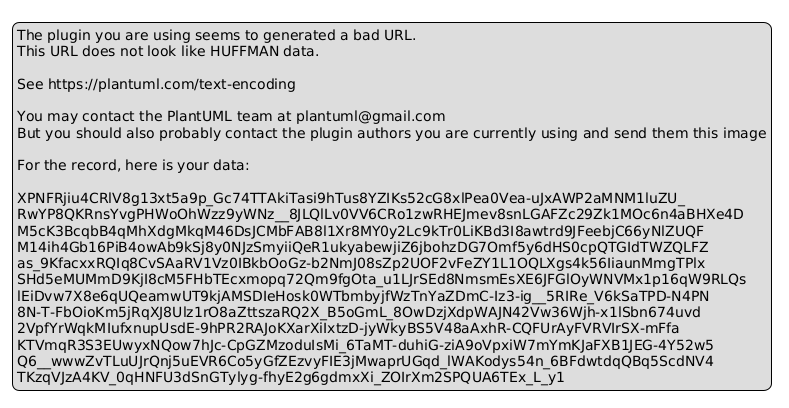

### 2. Class Diagram
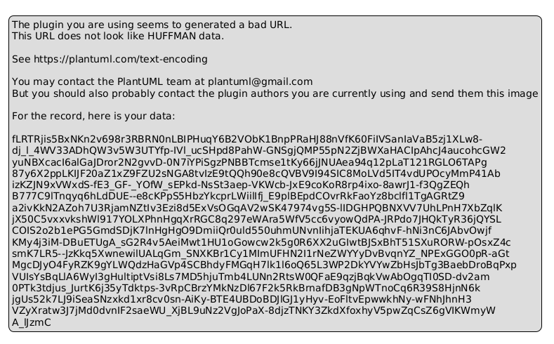

### 3. Component Diagram
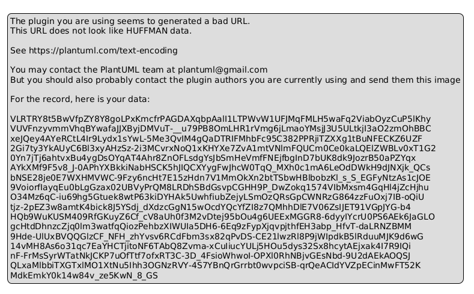

### 4. Deployment Diagram
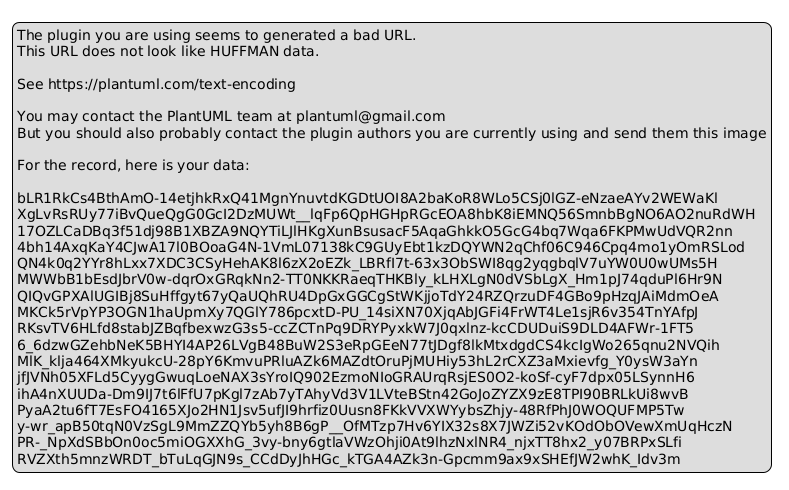

### 5. Entity-Relationship (ER) Diagram
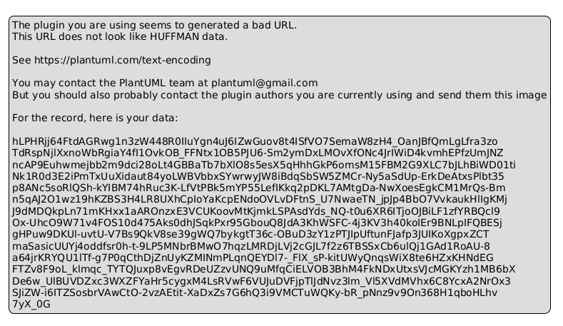

### 6. State Machine Diagram
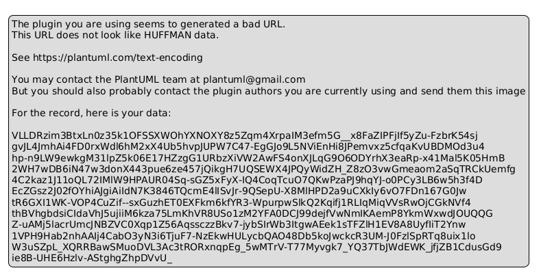

### 7. Activity Diagram
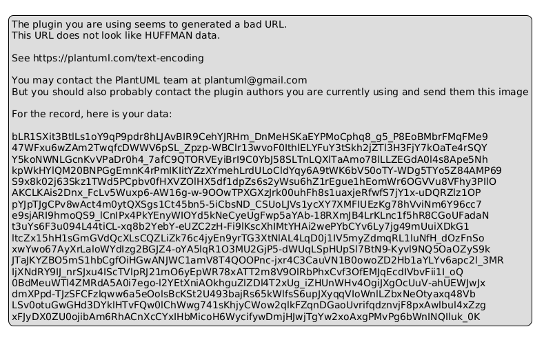

### 8. Authentication Sequence Diagram
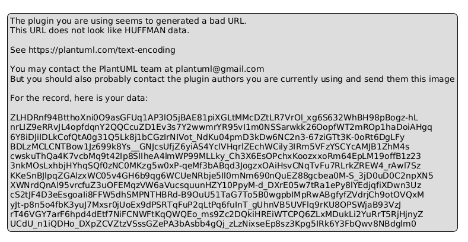

### 9. Report Found Item Sequence Diagram
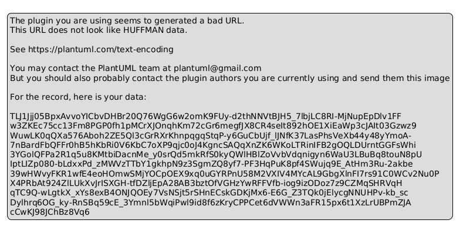

### 10. Report Lost Item Sequence Diagram
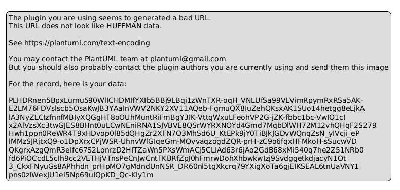

### 11. Claim Ownership Sequence Diagram
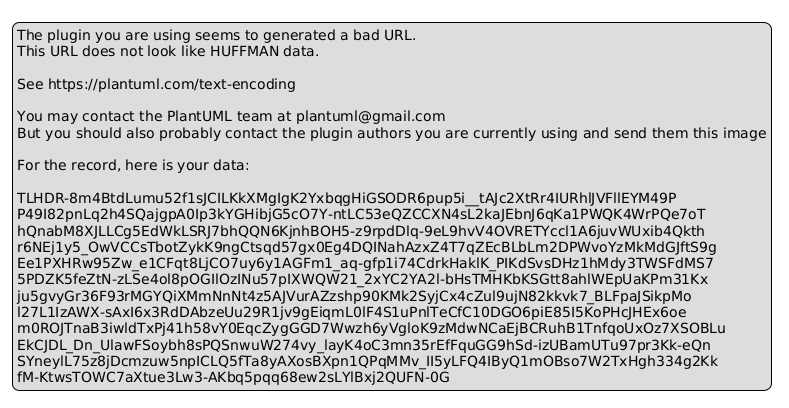

### 12. Physical Handover Sequence Diagram
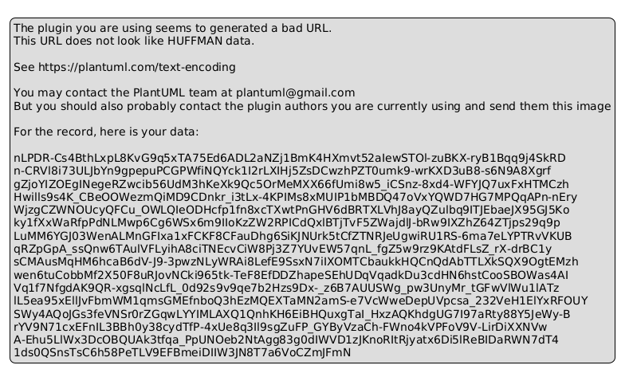
